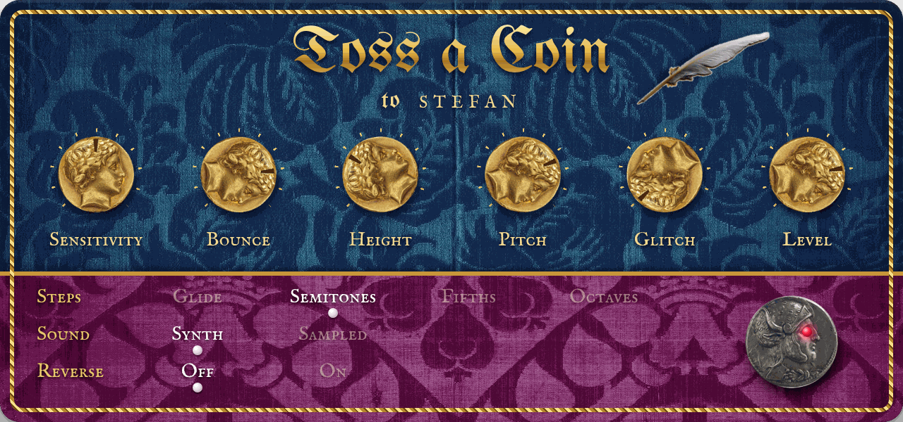

# Toss a Coin



**A pitch-to-rhythm pedal for [MOD Desktop](https://mod.audio/desktop/),
[MOD Dwarf](https://mod.audio/dwarf/), and any VST3 / CLAP / LV2 host.** Every hard
attack drops a coin on the floor. The note you played sets the size of the coin: a low
note is a fat coin whose bounces start slow, a high note is a small coin that clatters
quickly. The bounces speed up like a real dropped coin, ring like a small bell, and
step in pitch as they go.

Your dry signal passes through untouched and the coins are added on top. Soft playing
stays clean; only hard attacks drop a coin. Mono in, stereo out, built with the
[DISTRHO Plugin Framework (DPF)](https://github.com/DISTRHO/DPF).

The name nods to the bard's song "Toss a Coin to Your Witcher".

**[Install](#install) · [Controls](#controls) · [Releases](../../releases/latest) · [Building & contributing](DEVELOPERS.md)**

## Controls

| Control | Range | Default | What it does |
|---|---|---|---|
| **Sensitivity** | 0–100 % | 50 % | How hard you have to hit a note to drop a coin. Turn it up if your picking doesn't trigger; turn it down if soft notes do. |
| **Bounce** | 70–97 % | 92 % | Each gap as a fraction of the one before. Low values give a short, quick skitter; high values give a long roll that takes seconds to settle. |
| **Height** | 0.1–1.5 s | 0.5 s | How high the coin falls from: the first gap for a low E (E2). Other notes scale from it, so higher notes always start quicker. |
| **Pitch** | −24…+24 st | +12 | How far the pitch travels over one drop. Positive climbs, negative falls. |
| **Steps** | Glide / Semitones / Fifths & octaves / Octaves | Semitones | Which notes the pitch path is allowed to land on, relative to the note you played. Glide slides smoothly. |
| **Glitch** | 0–100 % | 0 % | Chance that a bounce jumps to a random note. Some jumps snap back on the next bounce; others carry on from there. |
| **Reverse** | Off / On | Off | Flips the timing: the bounces start fast and loud, then slow down and fade out. |
| **Sound** | Synth / Sampled | Synth | *Synth* is a tuned metal plate with a bell-like ring. *Sampled* chops your own attack and repitches it for each bounce. |
| **Level** | −24…+6 dB | 0 dB | Coin volume. The dry signal always stays at unity. |

A few starting points:

- **Penny drop:** the defaults.
- **Gold rush:** Steps on *Fifths & octaves*, Pitch +19.
- **Cursed coin:** Glitch around 40 %.
- **Rewind:** Reverse on.

There's no key or scale setting, because a pedal can't know what key you're in. The
pitch steps are always relative to the note you played. Chords give whichever single
pitch the detector locks onto, and it tracks from about 40 Hz, so bass works too.

## Install

Every release ships ready-to-run bundles. Get the one for your platform from the
**[Releases page](../../releases/latest)**. Replace `X.Y.Z` below with the version you
downloaded. The plugin appears under brand **Stefan** as **Toss a Coin**.

### MOD Desktop (Linux)

Download `tossacoin-vX.Y.Z-linux-amd64.tar.gz` and copy `tossacoin.lv2/` into your MOD
Desktop plugin folder (by default `~/Documents/MOD Desktop/lv2/`):

```bash
tar xf tossacoin-vX.Y.Z-linux-amd64.tar.gz
cp -r tossacoin.lv2 ~/"Documents/MOD Desktop/lv2/"
```

Restart MOD Desktop and the plugin shows up in the plugin store.

### MOD Dwarf

Download `tossacoin-vX.Y.Z-dwarf-aarch64.tar.gz`, copy `tossacoin.lv2/` to the device,
and restart its audio stack:

```bash
tar xf tossacoin-vX.Y.Z-dwarf-aarch64.tar.gz
scp -O -r tossacoin.lv2 root@192.168.51.1:/root/.lv2/
ssh root@192.168.51.1 'systemctl restart jack2 mod-ui'
```

Then hard-refresh the MOD web UI (Ctrl+Shift+R).

### Desktop DAWs: VST3 / CLAP (Linux, Windows, macOS)

Download the build for your OS from the Releases page and put the plugin in your
system plugin folder:

| OS | Install |
|---|---|
| **Linux** | unpack into `~/.vst3/` and `~/.clap/` |
| **Windows** | unpack into `%COMMONPROGRAMFILES%\VST3\` and `%COMMONPROGRAMFILES%\CLAP\` |
| **macOS** | run the **unsigned** `.pkg` installer (right-click → Open to get past Gatekeeper) |

Rescan plugins in your DAW afterwards.

### Raspberry Pi / Patchbox OS

LV2 builds for `rpi-aarch64` and `patchbox-os-arm32` are on the Releases page as well.

## Building & contributing

Building from source, cross-compiling for the Dwarf, running the tests (`make test`)
and the release workflow are covered in **[DEVELOPERS.md](DEVELOPERS.md)**.

## Acknowledgements

- [DISTRHO Plugin Framework (DPF)](https://github.com/DISTRHO/DPF), the LV2 / VST3 /
  CLAP framework.
- [MOD Audio](https://mod.audio) for the Dwarf, MOD Desktop, mod-plugin-builder and the
  modgui format.
- Pedal artwork is built from public-domain and CC0 images, mostly from The
  Metropolitan Museum of Art's Open Access collection. Fonts are UnifrakturMaguntia
  and IM Fell English SC (SIL Open Font License). See
  [`modgui/img/CREDITS.md`](plugins/TossACoin/modgui/img/CREDITS.md).

## License

Plugin code is ISC-licensed. DPF is ISC-licensed (see [`dpf/LICENSE`](dpf/LICENSE)).
